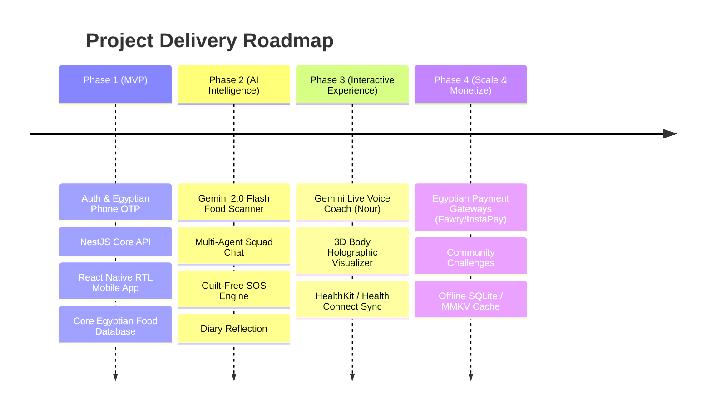
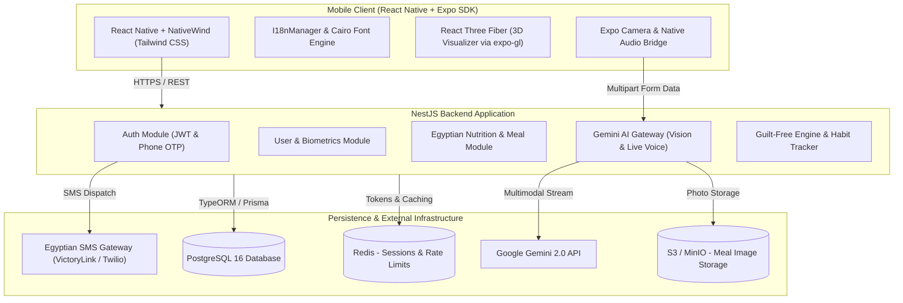
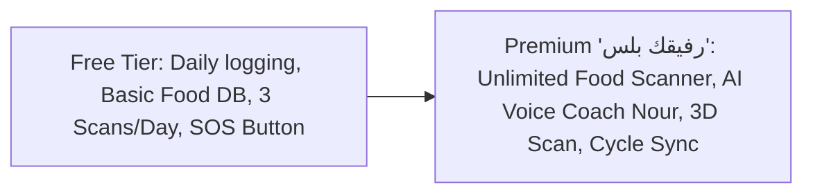

# Business Requirements Document (BRD)
## Project: رفيقك (Rafiqak) — Egyptian Wellness Companion UI - V2

**Document Version:** 1.0.0  
**Status:** Approved for Implementation  
**Target Market:** Egypt & MENA Region  
**Architecture Baseline:** NestJS (Backend) + React Native / Expo / NativeWind (iOS & Android Native Mobile App) + Google Gemini 2.0 (Multimodal Vision & Live Voice)

---

## 1. Executive Summary & Business Opportunity

### 1.1 Problem Statement
Existing health and weight-management applications (e.g., MyFitnessPal, Noom, Yazio) consistently fail in the Egyptian and broader Arab markets due to critical structural mismatches:
1. **Disconnected Food Databases**: Western apps fail to accurately represent authentic Egyptian home cooking (Koshary, Molokhia with rabbit/chicken, Mahshi varieties, Hawawshi, Taameya fried in local oils) and lack portion references understood in Egyptian households (e.g., "طبق غويط", "رغيف بلدي", "معلقة سمنة بلدي").
2. **Economic & Budget Incompatibility**: Global apps prescribe expensive superfoods (avocado, salmon, chia seeds, imported protein powder) detached from Egyptian household budget realities and local grocery inflation.
3. **Cold, Clinical, and Guilt-Inducing Tone**: Traditional fitness trackers trigger shame and guilt cycles when users exceed calorie targets, prompting high churn rates during holiday seasons (Ramadan, Eid, family gatherings).
4. **Language & RTL Gaps**: Machine-translated interfaces lack natural Egyptian colloquial phrasing ("ولا تشيل هم", "لخبطت؟ عادي كلنا بنلخبط") and often break right-to-left layout conventions.

### 1.2 Proposed Solution
**رفيقك (Rafiqak)** — featuring **"صاحبتك الذكية نور" (Nour)** — is an AI-native, empathetic wellness and lifestyle companion engineered specifically for the Egyptian market. It functions not as a strict digital warden, but as a trusted, non-judgmental best friend (*"صاحبتك القريبة / صاحبك الجدع"*). 

The platform integrates:
* **Egyptian Smart Food Logging & Scanner**: Computer vision tuned to Egyptian dishes and budget-friendly grocery optimization.
* **Empathetic AI Companion**: Duplex conversational voice coaching and a multi-persona support squad.
* **Guilt-Free Late-Night SOS**: Immediate damage-control mechanisms for emotional and late-night cravings.
* **Cycle-Aware & Adaptive Styling**: Tailored health insights for women aged 18–40, alongside an adaptive male/neutral dark aesthetic.

### 1.3 Strategic Business Objectives & KPIs
| Objective | Key Performance Indicator (KPI) | 6-Month Target |
| :--- | :--- | :--- |
| **User Acquisition** | Registered Accounts via Egyptian Mobile Number | 100,000 Users |
| **Engagement** | Daily Active Users (DAU) / Monthly Active Users (MAU) | > 35% |
| **Habit Formation** | 30-Day Food & Hydration Logging Retention | > 42% |
| **AI Utilization** | Voice Sessions & Food Scanner Invocations per User/Week | $\ge 4$ sessions/user/week |
| **Monetization** | Conversion from Free Tier to Paid Tier | 4.5% conversion |

---

## 2. Stakeholders & User Personas

### 2.1 Key Stakeholders
* **Product Owner & Technical Lead**: Oversees full-stack execution, system security, and API design.
* **Backend Engineer (NestJS)**: Owns core microservices, database schemas, local SMS gateway integration, and Gemini AI pipeline.
* **Frontend Lead (React / Tailwind)**: Delivers pixel-perfect RTL responsive mobile-first UI based on the Stitch Design System.
* **Clinical Nutrition & Cultural Advisor**: Validates Egyptian recipe nutritional breakdowns and caloric algorithms.

### 2.2 Target Personas

#### Primary Persona: "Sara" (The Working Mother / Professional)
* **Demographics**: 27 years old, Senior Specialist, Cairo (Nasr City).
* **Pain Points**: Chronic fatigue, emotional eating during stressful workdays, guilt after family weekend gatherings, struggles to balance diet with feeding her family on a budget.
* **Needs**: Empathetic check-in in Egyptian Arabic, meal ideas using pantry staples (lentils, fava beans, eggs, seasonal vegetables), menstrual cycle energy sync, non-judgmental accountability.

#### Secondary Persona: "Ahmed" (The Ambitious Engineer)
* **Demographics**: 31 years old, Backend Engineer, Alexandria.
* **Pain Points**: Wants to lose belly fat while working desk hours; gym apps demand weighing raw chicken breast and logging English barcodes.
* **Needs**: Quick food scan of Egyptian takeouts, masculine dark-mode dashboard with macro tracking, fast water & step synchronization.

---

## 3. Project Scope & Phased Rollout



* **In-Scope for Phase 1**:
  * Phone OTP Authentication (Egyptian Telecom providers).
  * 21 Responsive screens matching Stitch V2 specifications.
  * Comprehensive Egyptian Food Database (500+ authentic items).
  * Daily Dashboard, Hydration, Step counter, and Calorie logging.
  * Guilt-Free SOS module.
* **In-Scope for Phase 2**:
  * Camera Food Scanner via Gemini 2.0 Multimodal Vision.
  * AI Squad Chat with persona switching.
* **Out-of-Scope for Initial Release**:
  * Direct integration with hospital electronic health records (EHR).
  * Direct grocery delivery checkout (external affiliate links used instead).

---

## 4. Functional Requirements (FR)

### Module 1: Authentication & Onboarding
* **FR-1.1**: The system **shall** permit user registration and login using Egyptian mobile numbers (`+20 10/11/12/15XXXXXXXX`) via a 6-digit SMS OTP.
* **FR-1.2**: The system **shall** support social login via Google and Apple Sign-In.
* **FR-1.3**: The onboarding questionnaire **shall** capture user biometric data (age, height, weight, target weight), activity level, dietary budget tier (Budget-Friendly, Moderate, Flexible), and preferred companion tone.
* **FR-1.4**: The system **shall** provide dynamic theme customization supporting:
  * **Female Warm Mode** (Organic Sage `#215545` + Rose-Clay `#8F4A4E`).
  * **Male / Neutral Dark Mode** (Charcoal `#131412` + Slate-Teal `#2B5B6C`).

### Module 2: Egyptian Nutrition Engine & Smart Logging
* **FR-2.1**: The system **shall** maintain a categorized Egyptian food database with macro-nutritional distributions (Protein, Carbohydrates, Fats, Fiber) and authentic portion descriptors:
  * Bread: رغيف بلدي، نص رغيف، رغيف فينو.
  * Legumes & Breakfast: طبق فول بالزيت الحار، قرص طعمية، بيض مسلوق/بالسمنة.
  * Main Courses: طبق كشري وسط، ملوخية، محشي كرنب/ورق عنب بالصباع، حواوشي.
* **FR-2.2**: The system **shall** enable manual quick-logging for custom calories, water glasses ($250\text{ ml}$ increments), and step counts.
* **FR-2.3**: The system **shall** compute personalized Daily Caloric Targets using the Mifflin-St Jeor equation, modified for user pace selection (Gentle $\le 0.5\text{ kg/week}$, Moderate $0.75\text{ kg/week}$, Accelerated $1\text{ kg/week}$).

### Module 3: Computer Vision Food Scanner ("كاميرا السفرة المصرية")
* **FR-3.1**: The user **shall** be able to capture or upload a photo of an Egyptian meal from the client interface.
* **FR-3.2**: The backend **shall** process the image using Google Gemini 2.0 Flash with targeted Egyptian food prompting to return structured JSON:
  * Dish name (Arabic & English).
  * Estimated weight in grams and portion confidence score ($0.0 - 1.0$).
  * Estimated calories, protein, carbs, and fats.
  * Practical tips (e.g., *"خفف من الدقة والصلصة لو بتعاني من الحموضة"*).
* **FR-3.3**: The user **shall** be allowed to adjust or correct the AI's detected portion before confirming the log.

### Module 4: Conversational AI Voice Coach ("صاحبتك الذكية نور")
* **FR-4.1**: The application **shall** provide bidirectional, low-latency audio interaction with the AI persona "Nour".
* **FR-4.2**: The AI voice system **shall** communicate in friendly, educated Egyptian Arabic, utilizing warm acoustic inflection and positive psychology techniques.
* **FR-4.3**: The AI **shall** maintain session context across the conversation, recalling the user's logged meals, hydration status, and stated emotional state.

### Module 5: Late-Night Craving & Guilt-Free SOS ("زرار النجدة واللخبطة")
* **FR-5.1**: The home screen **shall** feature an accessible 1-tap SOS button available 24/7.
* **FR-5.2**: Upon activation, the system **shall** display an immediate de-escalation screen providing three interactive options:
  1. *"عايز آكل حاجة حلوة دلوقتي"* (Sweet craving diversion).
  2. *"لخبطت في العشا وحاسس بالذنب"* (Post-overeating emotional relief).
  3. *"مش قادر أنام وجعان"* (Late-night low-calorie smart alternatives).
* **FR-5.3**: The system **shall not** subtract penalty calories or trigger red warning states upon binge reports; it will instead schedule a gentle water reminder and recommend a restorative morning breakfast.

### Module 6: Menstrual Cycle-Aware Wellness (Female Mode)
* **FR-6.1**: The system **shall** predict menstrual cycle phases (Follicular, Ovulatory, Luteal, Menstrual) based on user input.
* **FR-6.2**: Daily caloric expenditure estimates and nutrient recommendations **shall** adapt dynamically to cycle phases (e.g., increasing magnesium and complex carbohydrate allowances by $150-200\text{ kcal}$ during the pre-menstrual luteal phase).

### Module 7: 3D Body Visualizer
* **FR-7.1**: The system **shall** render an interactive 3D humanoid silhouette using WebGL / Three.js.
* **FR-7.2**: The visualizer **shall** adjust body proportions based on user girth metrics (waist, hips, chest) and display progress without body-shaming visual cues.

---

## 5. Non-Functional Requirements (NFR)

### 5.1 Performance & Latency
* **NFR-1 (Food Scanner Latency)**: Food recognition and nutrition estimation shall return within $\le 2.0\text{ seconds}$ on a standard 4G mobile connection.
* **NFR-2 (Native App Performance & Launch)**: App cold-launch time shall not exceed $1.5\text{ seconds}$ on standard mid-range Android devices, and the initial binary download size shall be optimized under $25\text{ MB}$.
* **NFR-3 (API Response Time)**: Standard CRUD endpoints on the NestJS backend shall respond in $\le 120\text{ ms}$ at 95th percentile ($p95$).

### 5.2 Localization & Accessibility
* **NFR-4 (RTL Layout Guarantee)**: All components, animations, navigation drawers, and data cards must adhere strictly to `dir="rtl"` with mirrored icons.
* **NFR-5 (Typography Standard)**: The `Cairo` typeface shall be served locally with complete subsets for Arabic and Latin character sets.

### 5.3 Security, Privacy & Compliance
* **NFR-6 (Data Protection)**: All health and nutritional logs must be encrypted at rest (AES-256) and in transit (TLS 1.3).
* **NFR-7 (Stateless Session Tokens)**: Authentication shall utilize JWTs with 15-minute access expirations and 30-day rotating HTTP-only secure refresh tokens stored in Redis.
* **NFR-8 (Local Regulatory Adherence)**: Compliant with Egyptian Personal Data Protection Law No. 151 of 2020.

---

## 6. System Architecture & Component Design



### 6.1 Backend Modular Layout (NestJS)
```
src/
├── app.module.ts
├── common/
│   ├── decorators/
│   ├── filters/
│   └── guards/ (JwtAuthGuard, RolesGuard)
├── modules/
│   ├── auth/            # Phone OTP, Google OAuth, Refresh Tokens
│   ├── users/           # Biometric profile, target weights, preferences
│   ├── meals/           # Egyptian food catalog, meal logging, macro calculations
│   ├── ai/              # Gemini 2.0 Flash Vision, Prompt templates, Voice WebRTC
│   ├── sos/             # Craving triage rules, emotional journaling
│   └── cycle/           # Menstrual cycle forecasting & macro adaptations
└── database/
    ├── migrations/
    └── entities/
```

---

## 7. Business Model & Monetization Strategy

To align with local purchasing power in Egypt, the application utilizes a hybrid **Freemium + Micro-Subscription** structure:



| Plan | Pricing (EGP) | Target User | Features Included |
| :--- | :--- | :--- | :--- |
| **Free Tier** | **0 EGP** | All users | Manual meal logging, basic Egyptian food DB, 3 AI camera scans/day, full SOS tool. |
| **Monthly Pro** | **99 EGP / month** | Committed individuals | Unlimited AI Food Scans, Full Voice Coach Nour sessions, 3D Body Tracker, Cycle nutrition sync. |
| **Quarterly VIP** | **249 EGP / 3 months** | Habit transformation | All Pro features + priority response in AI Squad Chat + exportable PDF doctor report. |

* **Local Payment Channels Supported**:
  * **InstaPay** (Direct Egyptian bank transfers).
  * **Vodafone Cash, Orange Money, Etisalat Cash** (Mobile wallets).
  * **Fawry Pay** (Cash at kiosks).
  * Standard Visa / Mastercard (via Paymob or Fawry payment gateway).

---

## 8. Acceptance Criteria for MVP Launch

1. **Authentication**: Successful SMS OTP verification within $\le 30\text{ seconds}$ for all Egyptian carriers (Vodafone, Orange, Etisalat, WE).
2. **Food Logging**: User can search and log 10 staple Egyptian dishes with verified caloric breakdowns in $< 15\text{ seconds}$.
3. **Food Vision**: Uploading a photo of Egyptian Koshary correctly identifies the dish and estimates calories within a $15\%$ margin of error.
4. **Guilt-Free SOS**: Tapping the SOS button displays de-escalation tips with zero red warning/penalty indicators.
5. **Mobile Responsiveness**: UI renders flawlessly across viewport widths from $360\text{ px}$ to $430\text{ px}$ with native-feeling smooth touches and zero horizontal scroll overflow.

---

*Document approved by Lead Product Owner & Lead Systems Architect.*
