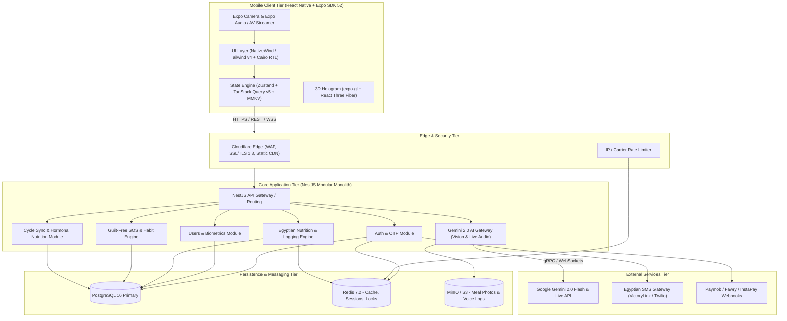
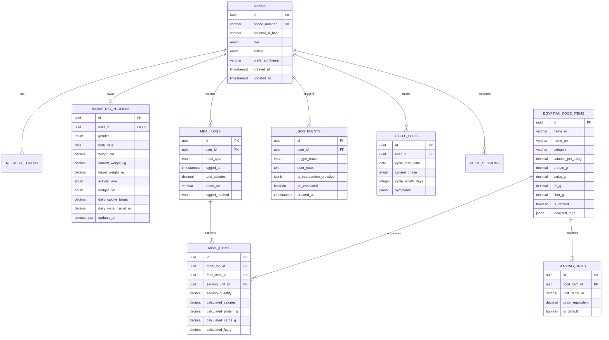
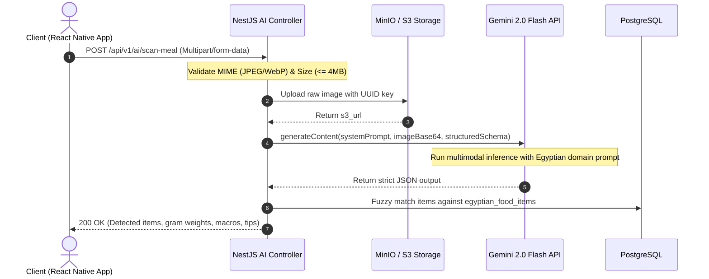
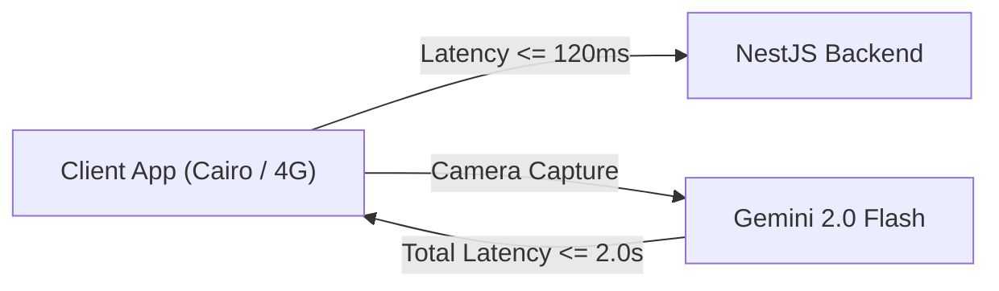
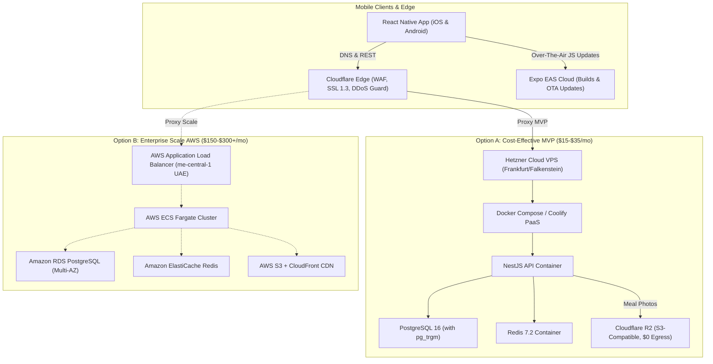

# Technical Design Document (TDD)
## Project: رفيقك (Rafiqak) — Egyptian Wellness Companion
**Document Version:** 1.0.0  
**Target Architecture:** NestJS (Modular Monolith) + PostgreSQL 16 + Redis + React Native (Expo SDK 52) / NativeWind + Google Gemini 2.0  
**Status:** Approved for Implementation  
**Companion Document:** [BRD.md](file:///Users/ameer/Desktop/project/BRD.md)

---

## 1. Executive Technical Summary & System Architecture

### 1.1 Architecture Blueprint
Rafiqak follows a **Modular Monolith** architecture pattern using NestJS on the backend and a **high-performance Native Mobile App (React Native + Expo SDK)** on the client side. This guarantees fluid 60/120fps native animations, native hardware access (Camera, Haptics, Audio, HealthKit/Health Connect), and real iOS and Android UI rendering, while retaining the capability to export a companion web app via Expo Web.



---

## 2. Database Architecture & Data Dictionary (PostgreSQL 16)

The relational schema is normalized (3NF) with targeted JSONB indexing for flexible AI-generated responses and dynamic nutrient distributions.

### 2.1 Entity Relationship Diagram (ERD)



### 2.2 PostgreSQL DDL & Indexing Strategy

```sql
-- Extensions
CREATE EXTENSION IF NOT EXISTS "uuid-ossp";
CREATE EXTENSION IF NOT EXISTS "pg_trgm"; -- For fast Arabic fuzzy search

-- Enums
CREATE TYPE user_role AS ENUM ('USER', 'PREMIUM', 'ADMIN', 'NUTRITIONIST');
CREATE TYPE user_status AS ENUM ('PENDING_VERIFICATION', 'ACTIVE', 'SUSPENDED');
CREATE TYPE gender_type AS ENUM ('FEMALE', 'MALE', 'UNSPECIFIED');
CREATE TYPE activity_level AS ENUM ('SEDENTARY', 'LIGHT', 'MODERATE', 'VERY_ACTIVE');
CREATE TYPE budget_tier AS ENUM ('BUDGET_FRIENDLY', 'MODERATE', 'FLEXIBLE');
CREATE TYPE meal_type AS ENUM ('BREAKFAST', 'LUNCH', 'DINNER', 'SNACK', 'LATE_NIGHT');
CREATE TYPE log_method AS ENUM ('MANUAL', 'AI_CAMERA', 'VOICE_NOUR', 'BARCODE');
CREATE TYPE cycle_phase AS ENUM ('MENSTRUAL', 'FOLLICULAR', 'OVULATORY', 'LUTEAL');

-- Users Table
CREATE TABLE users (
    id UUID PRIMARY KEY DEFAULT uuid_generate_v4(),
    phone_number VARCHAR(15) UNIQUE NOT NULL, -- e.g., +201012345678
    password_hash VARCHAR(255) NULL,
    role user_role DEFAULT 'USER' NOT NULL,
    status user_status DEFAULT 'PENDING_VERIFICATION' NOT NULL,
    preferred_theme VARCHAR(30) DEFAULT 'FEMALE_WARM' NOT NULL,
    created_at TIMESTAMPTZ DEFAULT NOW() NOT NULL,
    updated_at TIMESTAMPTZ DEFAULT NOW() NOT NULL
);
CREATE INDEX idx_users_phone ON users(phone_number);

-- Biometric Profiles
CREATE TABLE biometric_profiles (
    id UUID PRIMARY KEY DEFAULT uuid_generate_v4(),
    user_id UUID UNIQUE NOT NULL REFERENCES users(id) ON DELETE CASCADE,
    gender gender_type NOT NULL,
    birth_date DATE NOT NULL,
    height_cm NUMERIC(5,2) NOT NULL CHECK (height_cm > 50 AND height_cm < 260),
    current_weight_kg NUMERIC(5,2) NOT NULL CHECK (current_weight_kg > 20 AND current_weight_kg < 350),
    target_weight_kg NUMERIC(5,2) NOT NULL,
    activity_level activity_level DEFAULT 'LIGHT' NOT NULL,
    budget_tier budget_tier DEFAULT 'MODERATE' NOT NULL,
    daily_calorie_target NUMERIC(6,1) NOT NULL,
    daily_water_target_ml INTEGER DEFAULT 2500 NOT NULL,
    updated_at TIMESTAMPTZ DEFAULT NOW() NOT NULL
);

-- Egyptian Food Database (Optimized for Trigram search in Arabic)
CREATE TABLE egyptian_food_items (
    id UUID PRIMARY KEY DEFAULT uuid_generate_v4(),
    name_ar VARCHAR(150) NOT NULL,
    name_en VARCHAR(150) NULL,
    category VARCHAR(50) NOT NULL,
    calories_per_100g NUMERIC(6,2) NOT NULL,
    protein_g NUMERIC(5,2) DEFAULT 0.00 NOT NULL,
    carbs_g NUMERIC(5,2) DEFAULT 0.00 NOT NULL,
    fat_g NUMERIC(5,2) DEFAULT 0.00 NOT NULL,
    fiber_g NUMERIC(5,2) DEFAULT 0.00 NOT NULL,
    is_verified BOOLEAN DEFAULT TRUE NOT NULL,
    localized_tags JSONB DEFAULT '[]'::jsonb,
    created_at TIMESTAMPTZ DEFAULT NOW() NOT NULL
);
-- Trigram Index for Arabic full-text fuzzy lookup
CREATE INDEX idx_food_name_ar_trgm ON egyptian_food_items USING gin (name_ar gin_trgm_ops);

-- Authentic Portion Units
CREATE TABLE serving_units (
    id UUID PRIMARY KEY DEFAULT uuid_generate_v4(),
    food_item_id UUID NOT NULL REFERENCES egyptian_food_items(id) ON DELETE CASCADE,
    unit_name_ar VARCHAR(80) NOT NULL, -- e.g. "رغيف بلدي", "طبق وسط", "معلقة كبيرة"
    gram_equivalent NUMERIC(6,2) NOT NULL,
    is_default BOOLEAN DEFAULT FALSE NOT NULL
);
CREATE INDEX idx_serving_units_food ON serving_units(food_item_id);

-- Meal Logs
CREATE TABLE meal_logs (
    id UUID PRIMARY KEY DEFAULT uuid_generate_v4(),
    user_id UUID NOT NULL REFERENCES users(id) ON DELETE CASCADE,
    meal_type meal_type NOT NULL,
    logged_at TIMESTAMPTZ DEFAULT NOW() NOT NULL,
    total_calories NUMERIC(6,1) NOT NULL,
    photo_url TEXT NULL,
    logged_method log_method DEFAULT 'MANUAL' NOT NULL,
    created_at TIMESTAMPTZ DEFAULT NOW() NOT NULL
);
CREATE INDEX idx_meal_logs_user_date ON meal_logs(user_id, logged_at);

-- Meal Items
CREATE TABLE meal_items (
    id UUID PRIMARY KEY DEFAULT uuid_generate_v4(),
    meal_log_id UUID NOT NULL REFERENCES meal_logs(id) ON DELETE CASCADE,
    food_item_id UUID NOT NULL REFERENCES egyptian_food_items(id),
    serving_unit_id UUID NULL REFERENCES serving_units(id),
    serving_quantity NUMERIC(5,2) DEFAULT 1.0 NOT NULL,
    calculated_calories NUMERIC(6,1) NOT NULL,
    calculated_protein_g NUMERIC(5,2) NOT NULL,
    calculated_carbs_g NUMERIC(5,2) NOT NULL,
    calculated_fat_g NUMERIC(5,2) NOT NULL
);
CREATE INDEX idx_meal_items_log ON meal_items(meal_log_id);

-- SOS Emergency Cravings
CREATE TABLE sos_events (
    id UUID PRIMARY KEY DEFAULT uuid_generate_v4(),
    user_id UUID NOT NULL REFERENCES users(id) ON DELETE CASCADE,
    trigger_reason VARCHAR(100) NOT NULL,
    user_notes TEXT NULL,
    ai_intervention_provided JSONB NOT NULL,
    de_escalated BOOLEAN DEFAULT TRUE NOT NULL,
    created_at TIMESTAMPTZ DEFAULT NOW() NOT NULL
);
CREATE INDEX idx_sos_events_user ON sos_events(user_id, created_at);

-- Menstrual Cycle Tracking
CREATE TABLE cycle_logs (
    id UUID PRIMARY KEY DEFAULT uuid_generate_v4(),
    user_id UUID NOT NULL REFERENCES users(id) ON DELETE CASCADE,
    cycle_start_date DATE NOT NULL,
    current_phase cycle_phase NOT NULL,
    cycle_length_days INTEGER DEFAULT 28 NOT NULL,
    symptoms JSONB DEFAULT '[]'::jsonb,
    created_at TIMESTAMPTZ DEFAULT NOW() NOT NULL
);
CREATE INDEX idx_cycle_user ON cycle_logs(user_id, cycle_start_date);
```

---

## 3. Redis Cache & Distributed State Design

Redis 7.2 acts as the high-throughput, low-latency coordination layer:

| Key Pattern | Data Structure | TTL | Purpose |
| :--- | :--- | :--- | :--- |
| `otp:req:{phoneNumber}` | String (Counter) | 15 mins (900s) | Sliding window rate limit (Max 3 SMS / 15 min). |
| `otp:code:{phoneNumber}` | Hash (`{code, attempts}`) | 3 mins (180s) | Stores salted argon2 hash of the 6-digit OTP. |
| `session:refresh:{userId}:{tokenId}` | String (`ip, userAgent`) | 30 days | JWT refresh token revocation whitelist. |
| `cache:food:search:{sha256(query)}` | String (JSON) | 6 hours | Cached search results for high-frequency queries. |
| `user:daily_summary:{userId}:{YYYYMMDD}` | Hash (Totals) | 24 hours | Quick dashboard retrieval of consumed calories & water. |
| `ai:voice:session:{sessionId}` | Hash (Context) | 1 hour | Duplex audio context buffer for Nour. |

---

## 4. Google Gemini 2.0 AI Integration Pipeline

### 4.1 Vision Pipeline: Egyptian Food Recognition ("كاميرا السفرة المصرية")



#### Structured Output Schema for Gemini 2.0 Flash
The Gemini API call enforces strict JSON Schema output mode:

```json
{
  "type": "object",
  "properties": {
    "detected_dish_ar": { "type": "string" },
    "detected_dish_en": { "type": "string" },
    "confidence_score": { "type": "number", "minimum": 0, "maximum": 1 },
    "components": {
      "type": "array",
      "items": {
        "type": "object",
        "properties": {
          "item_name_ar": { "type": "string" },
          "estimated_grams": { "type": "number" },
          "calories": { "type": "number" },
          "protein_g": { "type": "number" },
          "carbs_g": { "type": "number" },
          "fat_g": { "type": "number" }
        },
        "required": ["item_name_ar", "estimated_grams", "calories", "protein_g", "carbs_g", "fat_g"]
      }
    },
    "total_estimated_calories": { "type": "number" },
    "cultural_health_tip_ar": { "type": "string" }
  },
  "required": [
    "detected_dish_ar",
    "detected_dish_en",
    "confidence_score",
    "components",
    "total_estimated_calories",
    "cultural_health_tip_ar"
  ]
}
```

#### System Prompt Template for Food Vision
```typescript
export const EGYPTIAN_FOOD_SCANNER_PROMPT = `
You are an expert Egyptian clinical nutritionist specializing in authentic Egyptian home cooking and street food.
Analyze the user-submitted image of food taken in Egypt.

Guidelines:
1. Identify all recognizable components of the Egyptian dish (e.g., Koshary with dakkah and salsa, Molokhia, Mahshi varieties, Taameya, Fava beans with linseed oil, Baladi bread).
2. Distinguish traditional Egyptian cooking styles (e.g., use of ghee/samna baladi vs sunflower oil).
3. Estimate the portion sizes in grams based on standard Egyptian tableware (deep plate "طبق غويط", flat plate "طبق مسطح", baladi loaf "رغيف بلدي").
4. Provide a supportive, culturally resonant, guilt-free tip in Egyptian Arabic (اللهجة المصرية المعاصرة).
5. Output ONLY the defined structured JSON schema.
`;
```

---

### 4.2 Conversational AI Voice Coach ("صاحبتك الذكية نور")

* **Protocol:** Bidirectional Streaming via **WebSockets / WebRTC**.
* **Audio Format:** 16-bit Linear PCM, 16kHz or 24kHz sampling rate, single channel (mono).
* **System Persona:**
  * *Persona:* "نور" (Nour) — 28-year-old empathetic, warm Egyptian companion.
  * *Dialect:* Fluent, modern Egyptian colloquial (`"ولا يهمك يا فندم"`, `"يومك كان عامل إزاي؟"`, `"كلنا بنلخبط والمهم نكمل"`).
  * *Context Memory:* Injects the user's daily budget, logged food, and current menstrual cycle phase into the prompt preamble.

---

## 5. NestJS Modular Backend Architecture

```
backend/
├── src/
│   ├── main.ts                          # Bootstrap, Helmet, CORS, Swagger, ValidationPipe
│   ├── app.module.ts                    # Root module aggregating domain modules
│   ├── common/
│   │   ├── decorators/                  # @CurrentUser(), @Public(), @Roles()
│   │   ├── filters/                     # AllExceptionsFilter, HttpExceptionFilter
│   │   ├── guards/                      # JwtAuthGuard, RateLimitGuard, RolesGuard
│   │   ├── interceptors/                # TransformResponseInterceptor, LoggingInterceptor
│   │   └── utils/                       # CalorieCalculator (Mifflin-St Jeor), ArabicTransliterator
│   ├── modules/
│   │   ├── auth/                        # Phone OTP verification, JWT generation, Refresh token rotation
│   │   ├── users/                       # User entity, profile CRUD, biometrics calculation
│   │   ├── nutrition/                   # Food catalog, search with pg_trgm, meal logger
│   │   ├── ai/                          # Gemini Vision client, Gemini Live audio gateway, prompt manager
│   │   ├── sos/                         # Craving triage engine, de-escalation tips, habit tracking
│   │   ├── cycle/                       # Menstrual cycle prediction, luteal macro adjustments
│   │   └── payments/                    # Paymob / Fawry webhook handlers, tier upgrades
│   └── database/
│       ├── database.module.ts           # TypeORM / Prisma configuration
│       └── migrations/                  # Version-controlled schema migrations
```

---

## 6. Core REST API Specifications & Contracts

### 6.1 Authentication Module

#### Request OTP
* **Endpoint:** `POST /api/v1/auth/otp/request`
* **Rate Limit:** 3 requests / 15 minutes per IP and phone number.
* **Request Payload:**
```json
{
  "phoneNumber": "+201012345678"
}
```
* **Success Response (200 OK):**
```json
{
  "success": true,
  "message": "تم إرسال كود التحقق بنجاح",
  "expiresInSeconds": 180
}
```

#### Verify OTP
* **Endpoint:** `POST /api/v1/auth/otp/verify`
* **Request Payload:**
```json
{
  "phoneNumber": "+201012345678",
  "otp": "482910"
}
```
* **Success Response (200 OK):**
```json
{
  "accessToken": "eyJhbGciOiJIUzI1NiIsInR5cCI6...",
  "refreshToken": "d7b9318b-...",
  "user": {
    "id": "c71d2b1f-7230-466d-883c-1f5bebe8374d",
    "phoneNumber": "+201012345678",
    "isProfileComplete": true,
    "preferredTheme": "FEMALE_WARM"
  }
}
```

---

### 6.2 Nutrition & Logging Module

#### Search Egyptian Food Catalog
* **Endpoint:** `GET /api/v1/foods/search?q=كشري`
* **Success Response (200 OK):**
```json
[
  {
    "id": "e4a2c092-29bc-4a41-b8ef-b4b1239c87d1",
    "nameAr": "كشري مصري بالصلصة والدقة",
    "nameEn": "Egyptian Koshary",
    "category": "Main Dishes",
    "caloriesPer100g": 138.0,
    "proteinG": 4.2,
    "carbsG": 25.8,
    "fatG": 2.1,
    "servingUnits": [
      { "id": "u1", "unitNameAr": "طبق صغير", "gramEquivalent": 250 },
      { "id": "u2", "unitNameAr": "طبق وسط", "gramEquivalent": 450, "isDefault": true },
      { "id": "u3", "unitNameAr": "طبق كبير", "gramEquivalent": 650 }
    ]
  }
]
```

#### Log a Meal
* **Endpoint:** `POST /api/v1/meals/log`
* **Headers:** `Authorization: Bearer <accessToken>`
* **Request Payload:**
```json
{
  "mealType": "LUNCH",
  "loggedAt": "2026-11-23T14:30:00Z",
  "loggedMethod": "AI_CAMERA",
  "photoUrl": "https://storage.rafiqak.app/meals/2026/11/koshary.jpg",
  "items": [
    {
      "foodItemId": "e4a2c092-29bc-4a41-b8ef-b4b1239c87d1",
      "servingUnitId": "u2",
      "quantity": 1.0
    }
  ]
}
```
* **Success Response (201 Created):**
```json
{
  "id": "550e8400-e29b-41d4-a716-446655440000",
  "totalCalories": 621.0,
  "dailyRemainingCalories": 1179.0,
  "message": "بالهنا والشفا! تم تسجيل الوجبة بنجاح"
}
```

---

### 6.3 SOS Craving Engine

#### Trigger SOS De-Escalation
* **Endpoint:** `POST /api/v1/sos/trigger`
* **Request Payload:**
```json
{
  "triggerReason": "SWEET_CRAVING_LATE_NIGHT",
  "notes": "عايز آكل بسبوسة أو شوكولاتة"
}
```
* **Success Response (200 OK):**
```json
{
  "interventionType": "GENTLE_DEFLECTION",
  "headlineAr": "ولا تشيل هم، طبيعي جداً بعد يوم طويل",
  "recommendedAlternatives": [
    {
      "nameAr": "زبادي لايت مع معلقة عسل ورشة قرفة",
      "calories": 110,
      "prepTimeMinutes": 2
    },
    {
      "nameAr": "شاي بلبن خالي الدسم مع بسكوتة شوفان واحدة",
      "calories": 85,
      "prepTimeMinutes": 3
    }
  ],
  "soundBiteUrl": "https://cdn.rafiqak.app/audio/sos/nour_calm_sweet.mp3"
}
```

---

## 7. Mobile App Architecture (React Native + Expo SDK 52 + NativeWind)

### 7.1 Tech Stack Matrix
* **Core Runtime:** React Native 0.76+ (React 19 & New Architecture enabled: Fabric + TurboModules).
* **Application Framework:** Expo SDK 52 (Continuous Native Generation / Prebuild).
* **Routing & Navigation:** Expo Router v4 (Type-safe, file-based routing supporting Native Stack, Tabs, and Modals).
* **Styling Engine:** NativeWind v4 (Tailwind CSS engine compiling directly to native `StyleSheet` primitives).
* **RTL & Localization:** React Native `I18nManager.allowRTL(true)` + `I18nManager.forceRTL(true)` with Cairo font subsetting via `expo-font`.
* **3D Visualizer:** `@react-three/fiber` with `expo-gl` (Hardware-accelerated native WebGL context for 3D body silhouette).
* **Media & Hardware:**
  * Vision Scanner: `expo-camera` with high-speed native JPEG frame capture.
  * Voice Coach: `expo-av` / `expo-audio` with low-latency PCM audio streaming over WebSockets.
  * Micro-interactions: `expo-haptics` for tactile feedback during SOS and logging.
* **Client State & Cache:** Zustand (Client/UI state) + TanStack Query v5 (Server state) + `react-native-mmkv` (Synchronous encrypted local storage).

### 7.2 Directory Organization (Expo Router Standard)
```
mobile/
├── app.json                     # Expo config: package name, permissions, plugins
├── babel.config.js              # NativeWind & Reanimated plugins
├── app/                         # File-based navigation routes
│   ├── _layout.tsx              # Root layout: ThemeProvider, QueryClient, FontLoader
│   ├── (auth)/
│   │   ├── login.tsx            # Egyptian phone OTP screen
│   │   └── onboarding.tsx       # Biometrics, budget tier & goal questionnaire
│   ├── (tabs)/                  # Main bottom navigation
│   │   ├── _layout.tsx          # Tab bar with animated indicators
│   │   ├── index.tsx            # Daily Dashboard & calorie ring
│   │   ├── diary.tsx            # Meal & hydration log timeline
│   │   └── profile.tsx          # User profile, theme switcher & cycle settings
│   ├── scanner/
│   │   └── camera.tsx           # Fullscreen camera with Egyptian meal overlay
│   ├── voice/
│   │   └── nour-coach.tsx       # Interactive duplex voice screen with audio wave
│   └── sos/
│       └── emergency.tsx        # 1-tap guilt-free craving modal
├── components/
│   ├── ui/                      # Button, Card, BottomSheet, Input (NativeWind)
│   ├── visualizer3d/            # BodyCanvas.tsx (expo-gl Three.js viewport)
│   └── nutrition/               # MacroProgressBar, FoodSearchItem
├── hooks/                       # useAuth, useDailyLog, useAudioRecorder, useRTL
├── stores/                      # useThemeStore, useUserStore, useSOSStore
└── assets/
    ├── fonts/                   # Cairo-Bold.ttf, Cairo-Regular.ttf
    └── models/                  # body_silhouette.glb
```

### 7.3 Design Tokens & Dual-Theme System (NativeWind v4)
Theme tokens adapt dynamically through CSS variables configured in NativeWind and React Native context:

```typescript
// theme.config.ts
export const themes = {
  femaleWarm: {
    primary: '#215545',       // Organic Forest Sage
    primaryLight: '#E8F0EC',
    accent: '#8F4A4E',        // Rose-Clay (Empathetic)
    accentSoft: '#F9ECEC',
    background: '#FAF8F5',    // Warm Alabaster
    surface: '#FFFFFF',
    textMain: '#1C2421',
    textMuted: '#6B7A75',
  },
  maleDark: {
    primary: '#2B5B6C',       // Slate-Teal
    primaryLight: '#16242B',
    accent: '#D47942',        // Warm Copper
    accentSoft: '#2B1D15',
    background: '#131412',    // Matte Charcoal
    surface: '#1E201C',
    textMain: '#EAECE8',
    textMuted: '#8F958D',
  },
};
```

---

## 8. Non-Functional Requirements & Performance SLAs



| Metric | Target SLA | Implementation Guarantee |
| :--- | :--- | :--- |
| **Food Scanner Latency** | $\le 2.0\text{ seconds}$ | Client-side Canvas resize ($1024\text{px}$, WebP 80% compression) + Gemini 2.0 Flash streaming. |
| **Native App Launch SLA** | Cold start $\le 1.5\text{ seconds}$ | Hermes JavaScript engine bytecode precompilation + lazy module loading. |
| **API Response (p95)** | $\le 120\text{ ms}$ | Redis query cache for food search, composite DB indexes, connection pooling via PgBouncer. |
| **RTL Rendering** | $100\%$ visual parity | Automated Playwright visual regression tests with mirrored gestures and directional flex layouts. |

---

## 9. Security, Compliance & Regulatory Adherence

### 9.1 Compliance with Egyptian Data Protection Law (No. 151 of 2020)
1. **Consent & Purpose Limitation:** The user must explicitly opt in during onboarding to processing health and menstrual biometric data.
2. **Right to Forgotten:** `DELETE /api/v1/users/me` implements an automated cascading purge across PostgreSQL, Redis, and S3 within 24 hours.
3. **Data Localization:** Deployment on regional AWS / Azure instances with local data residency compliance.

### 9.2 Cryptographic Safeguards
* **In-Transit:** TLS 1.3 enforced with HSTS (`max-age=31536000; includeSubDomains; preload`).
* **At-Rest:** PostgreSQL database volume encrypted with AES-256 (AWS KMS-managed keys).
* **Token Security:**
  * Access Tokens: Short-lived (15 minutes), signed with asymmetric RSA-256 (`RS256`).
  * Refresh Tokens: Stored in HTTP-only, `SameSite=Strict`, `Secure` cookies with rotating IDs.

---

## 10. DevOps, Cloud Infrastructure & Deployment Blueprint

### 10.1 Cloud Hosting Architecture & Deployment Topologies

Rafiqak adopts a two-tier cloud hosting roadmap to balance startup capital efficiency with high-scale enterprise resilience.



#### Comparison Matrix: Option A (MVP) vs Option B (Enterprise)

| Dimension | Option A: Bootstrapped MVP (Recommended Start) | Option B: Enterprise Scale AWS |
| :--- | :--- | :--- |
| **Monthly Cost** | **$15 – $35 / month** | **$150 – $350+ / month** |
| **Target Scale** | 0 – 50,000 active users | 50,000 – 1,000,000+ active users |
| **Compute Engine** | Hetzner Cloud VPS (4 vCPU, 8GB RAM) managed via Coolify or Docker Compose | AWS ECS Fargate auto-scaling tasks |
| **Database** | PostgreSQL 16 container with persistent NVMe volume + automated off-site backups | AWS RDS PostgreSQL 16 (Multi-AZ, Read Replicas) |
| **Cache & Sessions** | Redis 7.2 Alpine container | AWS ElastiCache (Redis Cluster) |
| **Object Storage** | Cloudflare R2 (**$0 egress fee**, S3-compatible) | AWS S3 Standard + CloudFront CDN |
| **Geographic Location** | Central Europe (Frankfurt / Falkenstein) $\approx 45-60\text{ ms}$ latency to Cairo | UAE (`me-central-1`) or Bahrain (`me-south-1`) $\approx 25-35\text{ ms}$ to Cairo |
| **Disaster Recovery** | Daily encrypted snapshots to Cloudflare R2 | Point-in-time recovery (PITR) across multiple availability zones |

---

### 10.2 Mobile Distribution & Over-The-Air (OTA) Updates
1. **Continuous Native Generation & Cloud Builds (Expo EAS)**:
   * **iOS**: Builds `.ipa` bundles distributed via Apple TestFlight (Internal/Beta) and the App Store.
   * **Android**: Builds `.aab` bundles for Google Play Store and direct installable `.apk` packages distributed via the official Rafiqak landing page.
2. **Instant Hotfixes via EAS Update**:
   * Bug fixes, UI improvements, and copy updates are published to user devices instantly over-the-air (`eas update --branch production`), bypassing App Store review cycles.

---

### 10.3 Regional Latency & Submarine Cable Route Optimization
Traffic originating from Egyptian telecom operators (Vodafone Egypt, Orange, Etisalat by e&, WE) reaches cloud nodes via Mediterranean submarine fiber cables:
* **Direct Peering (Europe / Mediterranean)**: Frankfurt (`eu-central-1`) and Marseille/Milan deliver $\approx 45\text{ ms}$ average round-trip times.
* **Middle East Peering**: AWS UAE (`me-central-1`) routes via the Red Sea corridor delivering $\approx 30\text{ ms}$ round-trip times.
* **Latency Mitigation**: Static assets and public food item metadata are cached at Cloudflare edge nodes located in Cairo and Alexandria.

---

### 10.4 Production Multi-Stage Dockerfile (NestJS Backend)
```dockerfile
# Multi-stage production build
FROM node:22-alpine AS builder
WORKDIR /app
COPY package*.json ./
RUN npm ci
COPY . .
RUN npm run build && npm prune --production

FROM node:22-alpine AS runner
WORKDIR /app
ENV NODE_ENV=production
COPY --from=builder /app/package*.json ./
COPY --from=builder /app/node_modules ./node_modules
COPY --from=builder /app/dist ./dist

USER node
EXPOSE 3000
CMD ["node", "dist/main.js"]
```

---

### 10.5 Zero-Egress Storage Architecture (Cloudflare R2)
Every food photo scan produces a $1024\text{ px}$ compressed WebP image (~$80-120\text{ KB}$).
* To eliminate AWS S3 egress egress transfer penalties, object storage is configured with **Cloudflare R2**:
  * S3 Endpoint: `https://<account_id>.r2.cloudflarestorage.com`
  * Egress Bandwidth Cost: **$0.00 / GB** (100% free)
  * Signed URLs: Generated via `@aws-sdk/s3-request-presigner` with 15-minute validity.

---

## 11. Engineering Traceability Matrix (BRD $\rightarrow$ TDD)

| BRD Requirement | TDD Component | Implementation Detail |
| :--- | :--- | :--- |
| **FR-1.1 (Egyptian Phone OTP)** | `AuthModule` + Redis | 6-digit OTP, VictoryLink SMS gateway, sliding rate limit. |
| **FR-2.1 (Egyptian Food DB)** | `NutritionModule` + Postgres | `egyptian_food_items` table with Trigram GIN indexing on `name_ar`. |
| **FR-3.1 (Camera Food Scanner)** | `AIModule` + Gemini 2.0 | Gemini 2.0 Flash multimodal JSON mode with Egyptian domain prompts. |
| **FR-4.1 (AI Voice Coach Nour)** | `AIModule` + WebSockets | Duplex streaming PCM audio with session context stored in Redis. |
| **FR-5.1 (Guilt-Free SOS)** | `SOSModule` | `sos_events` table, zero penalty deduction, de-escalation tips. |
| **FR-6.1 (Menstrual Cycle Sync)** | `CycleModule` | `cycle_logs` table, luteal phase +150-200 kcal dynamic adjustment. |
| **FR-7.1 (3D Body Visualizer)** | React Three Fiber + `expo-gl` | Native WebGL humanoid mesh with waist/hip/chest dimension morph targets. |
